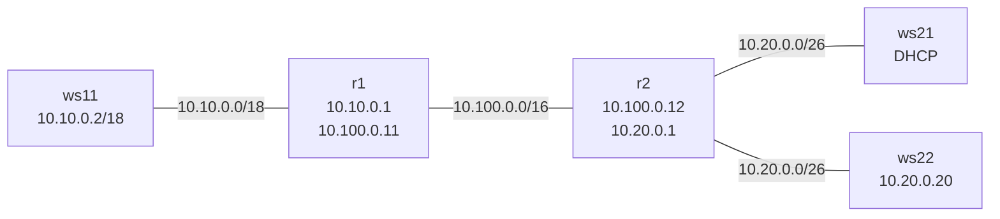
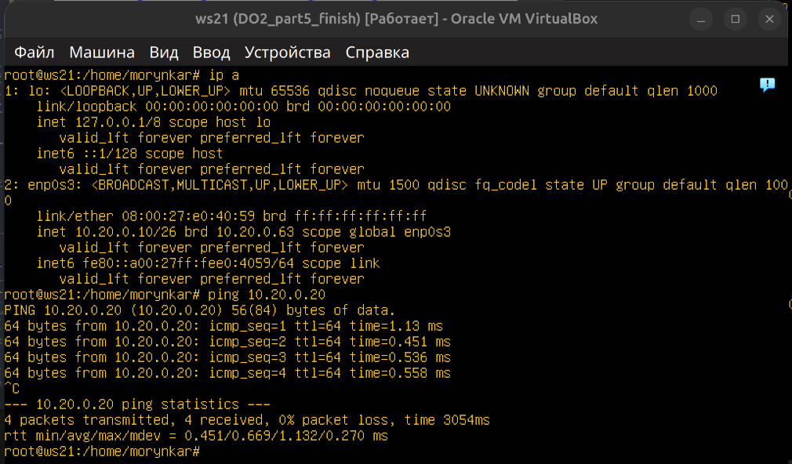

# DO2 — Linux Networking Lab

Практический проект по проектированию и диагностике виртуальной сети Linux. В лабораторном стенде настроены IPv4-адресация, статическая маршрутизация, DHCP, фильтрация трафика, NAT и SSH-туннели. Маршрут пакетов подтверждён с помощью `tcpdump` и `traceroute`, а пропускная способность — с помощью `iperf3`.


## Цель

Собрать изолированный многосегментный стенд, обеспечить связность между рабочими станциями через два Linux-маршрутизатора и исследовать, как адресация, таблицы маршрутов, firewall и преобразование адресов влияют на прохождение пакетов.

## Топология



| Узел | Роль | Основной адрес |
|---|---|---|
| `ws11` | Клиент, DHCP reservation | `10.10.0.2/18` |
| `r1` | Маршрутизатор, DHCP-сервер | `10.10.0.1`, `10.100.0.11` |
| `r2` | Маршрутизатор, DHCP и NAT | `10.100.0.12`, `10.20.0.1` |
| `ws21` | DHCP-клиент | диапазон `10.20.0.2–50` |
| `ws22` | Веб-сервер | `10.20.0.20/26` |

## Реализовано

- рассчитаны подсети, маски и допустимые диапазоны узлов;
- настроены постоянные адреса и маршруты через Netplan;
- включена IPv4-переадресация на `r1` и `r2`;
- исследованы longest prefix match, TTL и ICMP-ошибки;
- измерена пропускная способность TCP между двумя VM;
- показано влияние порядка правил `iptables`;
- настроены динамическая выдача адресов и reservation по MAC;
- настроены SNAT и DNAT для доступа к Apache;
- проверены local и remote SSH port forwarding.

## Навигация

- [Адресация и двухузловая маршрутизация](docs/addressing.md)
- [Firewall и обнаружение узлов](docs/firewall.md)
- [Многоузловая маршрутизация](docs/routing.md)
- [DHCP](docs/dhcp.md)
- [NAT](docs/nat.md)
- [SSH-туннели](docs/ssh-tunnels.md)
- [Топология и адресный план](docs/topology.md)

Обезличенные рабочие примеры находятся в [`configs/`](configs/), безопасные лабораторные скрипты — в [`scripts/`](scripts/).

## Быстрая проверка

Скрипт не изменяет систему и выводит интерфейсы, маршруты, состояние IP forwarding, правила firewall, DHCP lease и слушающие TCP-порты:

```bash
sudo ./scripts/verify-network.sh
```

Синтаксис всех Bash-скриптов проверяется командой:

```bash
bash -n scripts/*.sh
shellcheck scripts/*.sh
```

## Ключевые результаты

| Маршрутизация | DHCP | NAT |
|---|---|---|
|  |  |  |

## Ограничения

Стенд предназначен для изолированной сети VirtualBox. Скрипты firewall и NAT меняют сетевое состояние и должны запускаться только внутри лабораторных VM. Имена интерфейсов и адреса перед применением необходимо сверить со своей топологией.
