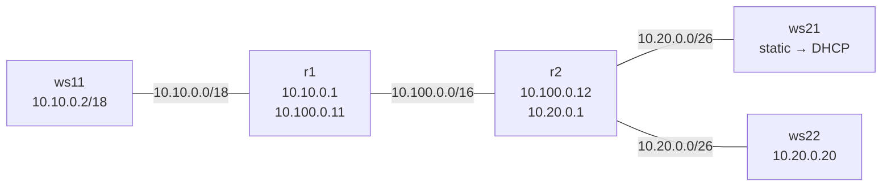
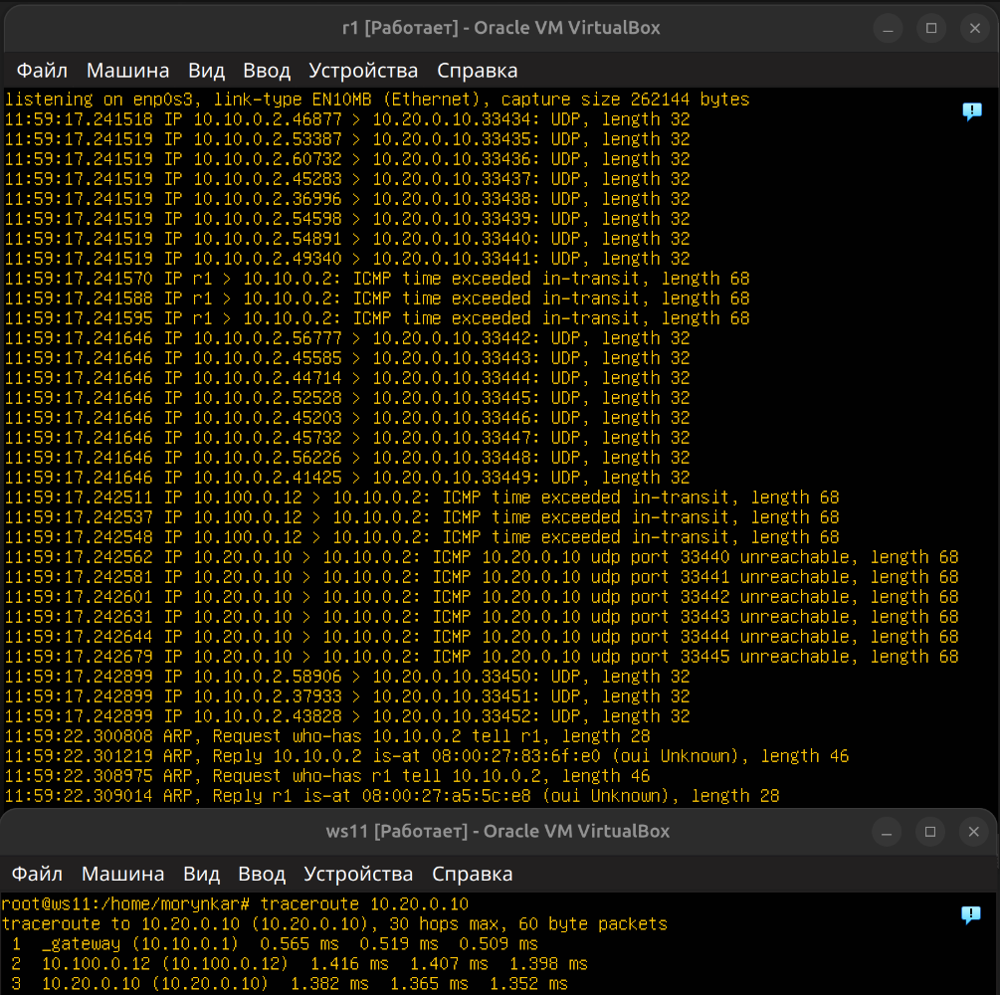
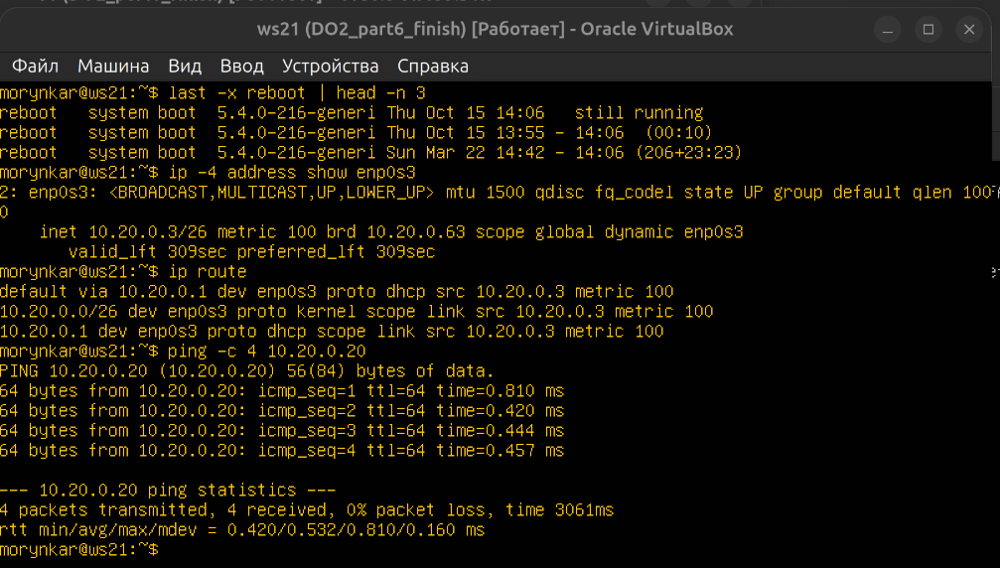
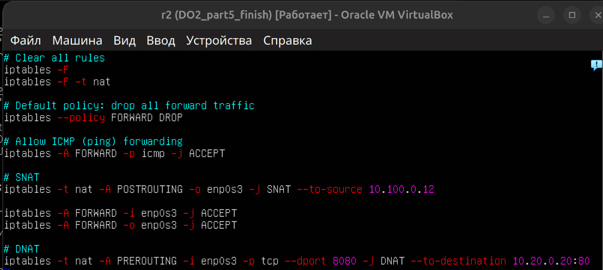

# DO2 — Linux Networking Lab

Практический проект по проектированию и диагностике виртуальной сети Linux. В лабораторном стенде настроены IPv4-адресация, статическая маршрутизация, DHCP, фильтрация трафика, NAT и SSH-туннели. Маршрут пакетов подтверждён с помощью `tcpdump` и `traceroute`, а пропускная способность — с помощью `iperf3`.

Все рабочие станции и маршрутизаторы развёрнуты как Ubuntu 20.04 Server LTS без графического окружения в VirtualBox.

## Документация

**[Начать с Part 1: расчёт сетей и адресов →](docs/addressing.md#part-1-расчёт-сетей-и-адресов)**

Отчёт повторяет последовательность выполненной лабораторной работы: от расчёта подсетей и соединения двух машин до маршрутизации нескольких сетей, DHCP, NAT и SSH-туннелей. Формулировки заданий пересказаны, а команды, результаты и скриншоты сохранены.

## Цель

Собрать изолированный многосегментный стенд, обеспечить связность между рабочими станциями через два Linux-маршрутизатора и исследовать, как адресация, таблицы маршрутов, firewall и преобразование адресов влияют на прохождение пакетов.

## Топология



| Узел | Роль | Основной адрес |
|---|---|---|
| `ws11` | Клиент, DHCP reservation | `10.10.0.2/18` |
| `r1` | Маршрутизатор, DHCP-сервер | `10.10.0.1`, `10.100.0.11` |
| `r2` | Маршрутизатор, DHCP и NAT | `10.100.0.12`, `10.20.0.1` |
| `ws21` | Рабочая станция | сначала `10.20.0.10`, затем DHCP-пул `10.20.0.2–19` и `10.20.0.21–50` |
| `ws22` | Веб-сервер | `10.20.0.20/26` |

## Ход лабораторной работы

1. **[Part 1. Расчёт сетей и адресов](docs/addressing.md#part-1-расчёт-сетей-и-адресов)** — перевод масок между форматами, определение адресов сети, диапазонов узлов и broadcast-адресов.
2. **[Part 2. Статическая маршрутизация между двумя машинами](docs/addressing.md#part-2-статическая-маршрутизация-между-двумя-машинами)** — настройка интерфейсов через Netplan, временных и постоянных маршрутов, проверка с помощью `ping`.
3. **[Part 3. Измерение скорости соединения](docs/addressing.md#part-3-измерение-скорости-соединения)** — запуск `iperf3` в режимах сервера и клиента и интерпретация результата.
4. **[Part 4. Сетевой экран](docs/firewall.md)** — создание правил `iptables`, сравнение стратегий DROP/ACCEPT и обнаружение доступных узлов.
5. **[Part 5. Статическая маршрутизация сети](docs/routing.md)** — сборка стенда из пяти машин, включение IP forwarding, добавление маршрутов и наблюдение пути пакета через `traceroute` и `tcpdump`.
6. **[Part 6. Динамическая настройка узлов](docs/dhcp.md)** — настройка DHCP-пулов, шлюза, DNS и закрепление адреса за MAC-адресом.
7. **[Part 7. Преобразование сетевых адресов](docs/nat.md)** — настройка Apache, проверка политики FORWARD, настройка SNAT и DNAT.
8. **[Part 8. SSH-туннели](docs/ssh-tunnels.md)** — проверка local и remote port forwarding для доступа к веб-сервису.

Отдельно приведены **[общая топология и адресный план стенда](docs/topology.md)**. На каждой странице отчёта есть полное меню и кнопки перехода к следующему или предыдущему этапу.

Обезличенные рабочие примеры находятся в [`configs/`](configs/), скрипты для лабораторных виртуальных машин — в [`scripts/`](scripts/).

## Быстрая проверка

Скрипт не изменяет систему и выводит интерфейсы, маршруты, состояние IP forwarding, правила firewall, DHCP lease и слушающие TCP-порты:

```bash
sudo ./scripts/verify-network.sh
```

Синтаксис всех Bash-скриптов проверяется командой:

```bash
bash -n scripts/*.sh
shellcheck scripts/*.sh
```

## Ключевые результаты

| Маршрутизация | DHCP | NAT |
|---|---|---|
|  |  |  |

## Ограничения

Стенд предназначен для изолированной сети VirtualBox. Скрипты firewall и NAT меняют сетевое состояние и должны запускаться только внутри лабораторных VM. Имена интерфейсов и адреса перед применением необходимо сверить со своей топологией.
