# Адресация и двухузловая маршрутизация

[← README](../README.md) · [Топология](topology.md) · **Адресация** · [Firewall](firewall.md) · [Маршрутизация](routing.md) · [DHCP](dhcp.md) · [NAT](nat.md) · [SSH-туннели](ssh-tunnels.md)

---

## Расчёт подсетей

### Для чего это нужно

Маска разделяет IPv4-адрес на сетевую и узловую части. До назначения адресов важно вычислить границы сети: адрес сети и broadcast нельзя выдавать обычным узлам, а шлюз должен находиться в том же сегменте, что и клиент.

Навыки двоичного представления масок и определения диапазона узлов проверены с помощью `ipcalc`:

```bash
ipcalc 192.167.38.54/13
ipcalc 12.167.38.4/23
```

Например, адрес `192.167.38.54/13` принадлежит сети `192.160.0.0/13`. Для каждой сети отдельно учитывались network address, broadcast address и допустимый диапазон узлов.

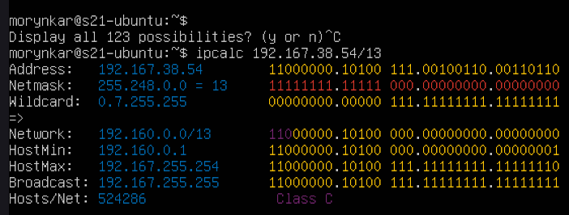

### Представление масок

| Исходная маска | Префикс | Двоичная запись |
|---|---:|---|
| `255.255.255.0` | `/24` | `11111111.11111111.11111111.00000000` |
| `255.254.0.0` | `/15` | `11111111.11111110.00000000.00000000` |
| `255.255.255.240` | `/28` | `11111111.11111111.11111111.11110000` |

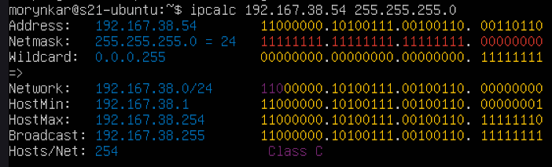

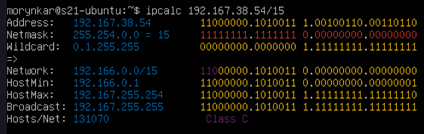

### Диапазоны узлов для 12.167.38.4

| Маска | Минимальный узел | Максимальный узел |
|---|---|---|
| `/8` | `12.0.0.1` | `12.255.255.254` |
| `/16` | `12.167.0.1` | `12.167.255.254` |
| `/23` | `12.167.38.1` | `12.167.39.254` |
| `/4` | `0.0.0.1` | `15.255.255.254` |

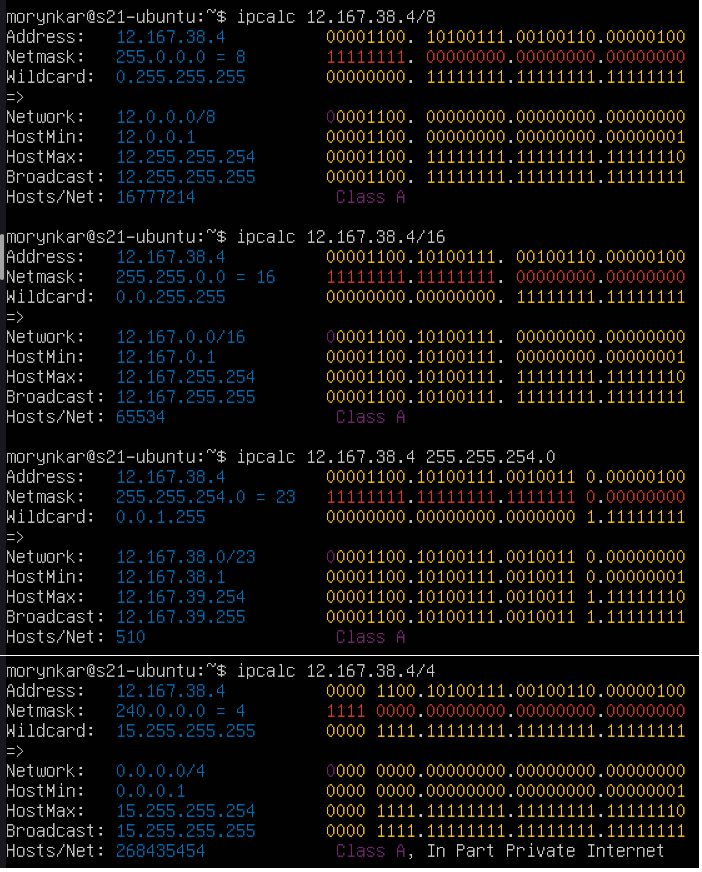

Частные диапазоны IPv4: `10.0.0.0/8`, `172.16.0.0/12` и `192.168.0.0/16`. Loopback занимает `127.0.0.0/8` и не маршрутизируется за пределы узла.

В лаборатории дополнительно сравнивались префиксная, десятичная и двоичная формы маски. Например, `/28` соответствует `255.255.255.240`: четыре единичных бита последнего октета дают размер блока 16 адресов.

### Loopback и публичные адреса

| Адрес | Доступ к локальному приложению |
|---|---|
| `194.34.23.100` | нет |
| `127.0.0.2` | да |
| `127.1.0.1` | да |
| `128.0.0.1` | нет |

Адреса `10.0.0.45`, `192.168.4.2`, `172.20.250.4`, `172.16.255.255` и `10.10.10.10` относятся к частным диапазонам. Остальные адреса из проверяемого набора являются публичными.

Для сети `10.10.0.0/18` допустимый диапазон узлов — `10.10.0.1–10.10.63.254`. Поэтому возможны gateway `10.10.0.2`, `10.10.10.10` и `10.10.1.255`; адреса `10.0.0.1` и `10.10.100.1` находятся вне сети.

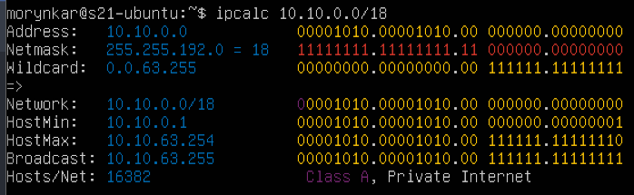

## Две рабочие станции

### Цель опыта

Проверить, смогут ли две машины из логически разных сетей обмениваться пакетами через общий виртуальный Ethernet-сегмент, если на них явно указать маршруты.

Для первого эксперимента использованы две VM в одной Internal Network. Им назначены адреса `192.168.100.10/16` и `172.24.116.8/12`.

Исходные интерфейсы и адреса проверены на обеих машинах:

```bash
ip address
```

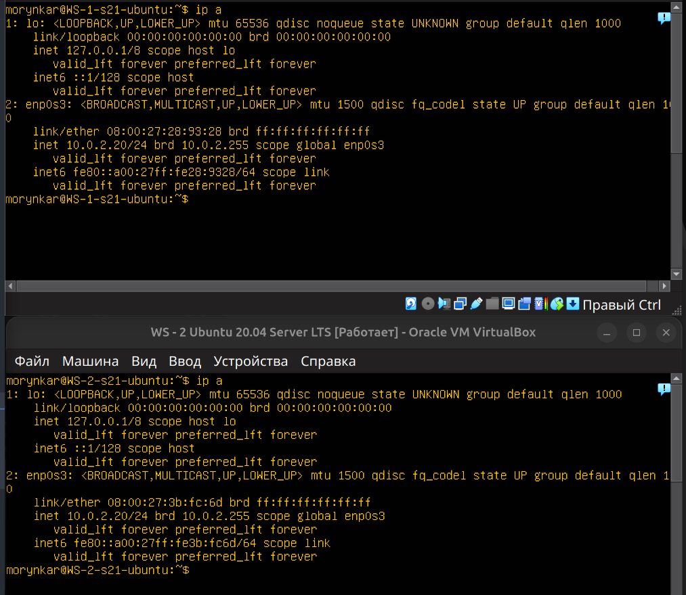

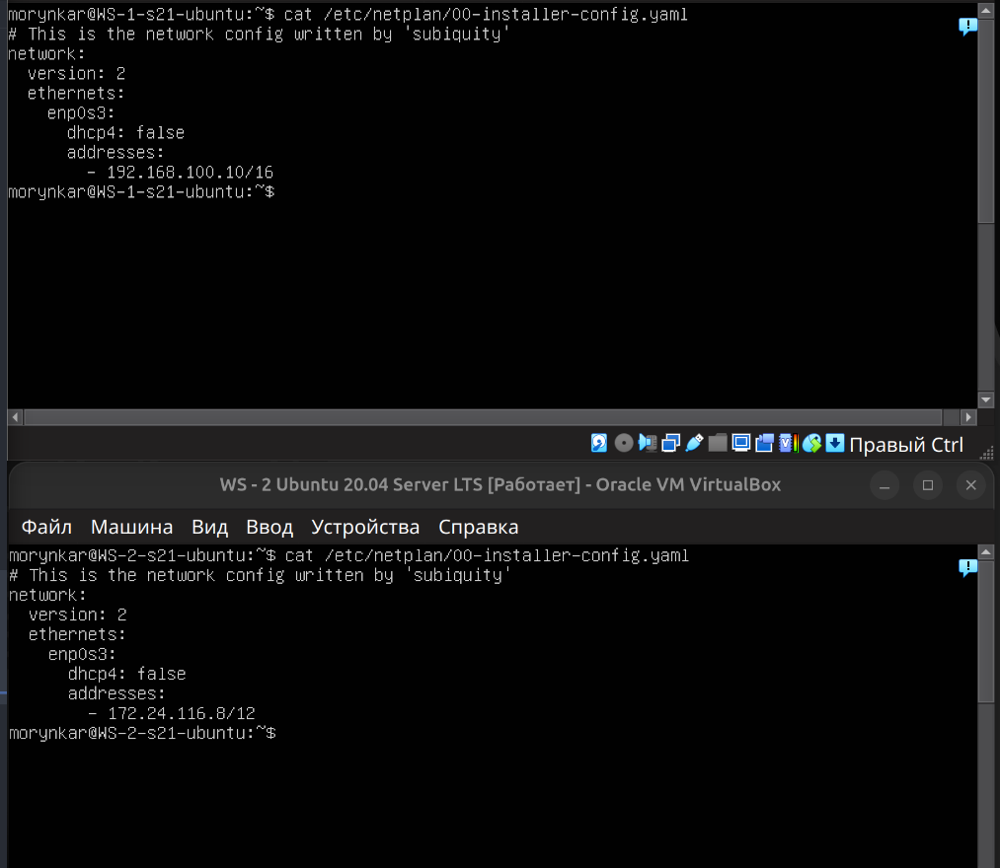

После изменения файлов сеть перезапущена командой `sudo netplan apply` на обеих VM.

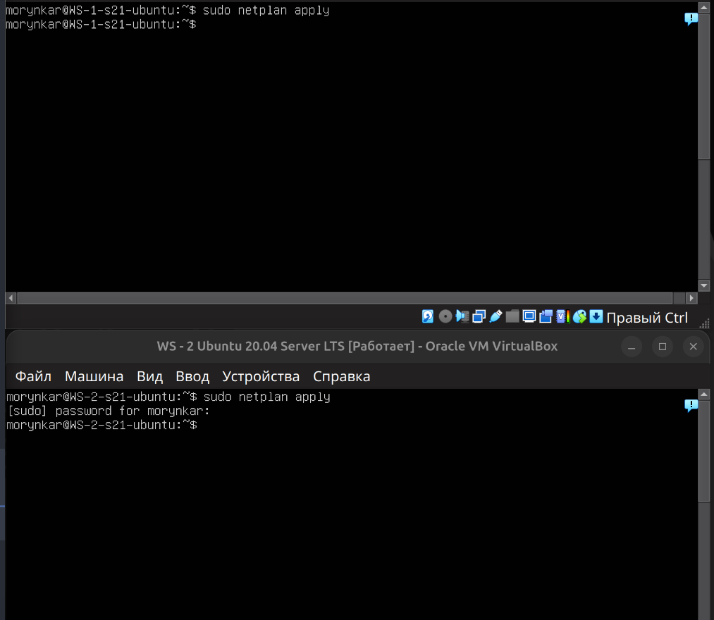

Поскольку адреса принадлежат разным сетям, на каждом узле временно добавлен маршрут через общий интерфейс:

```bash
# ws1
sudo ip route add 172.16.0.0/12 dev enp0s3

# ws2
sudo ip route add 192.168.0.0/16 dev enp0s3
```

После проверки маршруты перенесены в Netplan, чтобы они сохранялись после перезагрузки.

Команда `ip route add ... dev enp0s3` сообщает ядру, что указанная удалённая сеть достижима непосредственно через интерфейс. Next hop здесь не задаётся: обе VM подключены к одной внутренней сети VirtualBox и находят MAC друг друга через ARP.

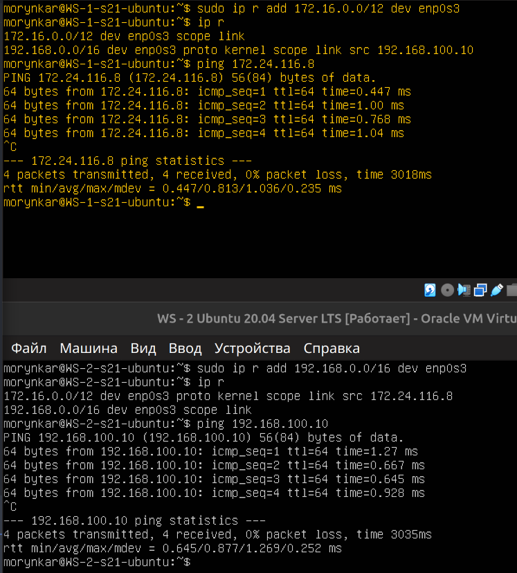

После переноса маршрутов в Netplan обе машины перезагружены. Содержимое конфигураций, таблицы маршрутизации и двусторонний `ping` проверены повторно.

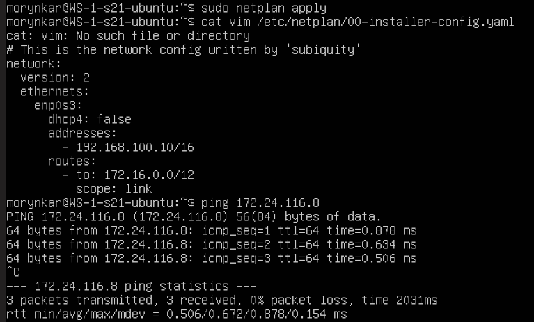

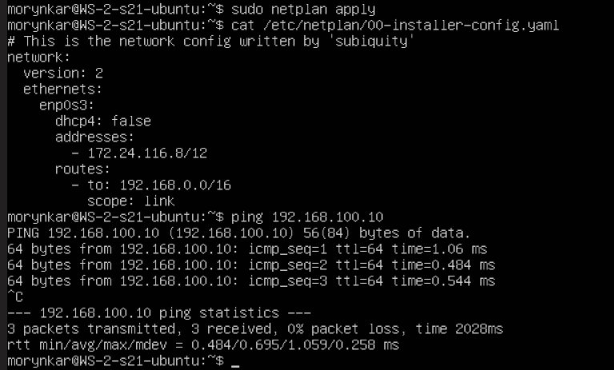

## Пропускная способность

Перед измерением выполнено преобразование единиц:

| Исходное значение | Результат |
|---|---|
| `8 Mbit/s` | `1 MB/s` |
| `100 MB/s` | `819200 Kbit/s` |
| `1 Gbit/s` | `1000 Mbit/s` |

На одной VM запущен сервер `iperf3`, на другой — клиент:

```bash
iperf3 -s
iperf3 -c 172.24.116.8
```

В десятисекундном TCP-тесте виртуальный стенд показал около `2.08 Gbit/s`. Это характеристика локальной виртуальной сети, а не физического интернет-канала.

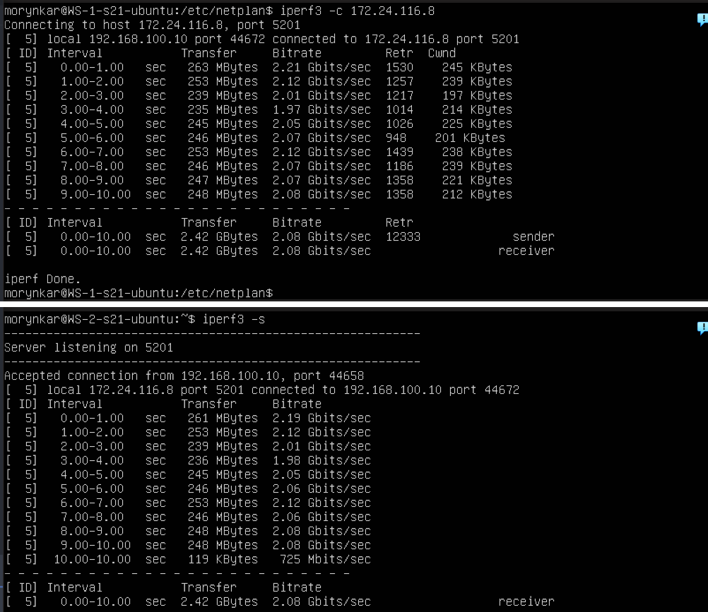

### Результат

Связность между двумя адресными пространствами подтверждена двусторонним `ping`, постоянные маршруты пережили перезагрузку, а `iperf3` показал фактическую пропускную способность виртуального канала.

---

[← Предыдущий этап: топология](topology.md) | [Следующий этап: firewall →](firewall.md)
