# Part 6. Динамическая настройка IP с помощью DHCP

[← README](../README.md) · [Схема](topology.md) · [Part 1](addressing.md#part-1-расчёт-сетей-и-адресов) · [Part 2](addressing.md#part-2-статическая-маршрутизация-между-двумя-машинами) · [Part 3](addressing.md#part-3-измерение-скорости-соединения) · [Part 4](firewall.md) · [Part 5](routing.md) · **Part 6** · [Part 7](nat.md) · [Part 8](ssh-tunnels.md)

---

## Цель этапа

Заменить ручное назначение адресов автоматической конфигурацией клиентов. Одновременно проверяются два сценария: свободная выдача адреса из пула и закрепление постоянного адреса за известным MAC.

DHCP-серверы развёрнуты на обоих маршрутизаторах. `r2` выдаёт динамические адреса узлам LAN 2, а `r1` закрепляет постоянный адрес `ws11` по MAC.

## Динамический пул

Основные параметры для сети `10.20.0.0/26`:

```dhcpd
subnet 10.20.0.0 netmask 255.255.255.192 {
    range 10.20.0.2 10.20.0.19;
    range 10.20.0.21 10.20.0.50;
    option routers 10.20.0.1;
    option domain-name-servers 10.20.0.1;
}
```

На исходном лабораторном скриншоте использован единый диапазон `10.20.0.2–10.20.0.50`. В повторяемом примере адрес `10.20.0.20` исключён из пула, поскольку статически назначен веб-серверу `ws22`; это устраняет потенциальный конфликт адресов.

Полный пример находится в [`configs/dhcp/r2-dhcpd.conf`](../configs/dhcp/r2-dhcpd.conf).

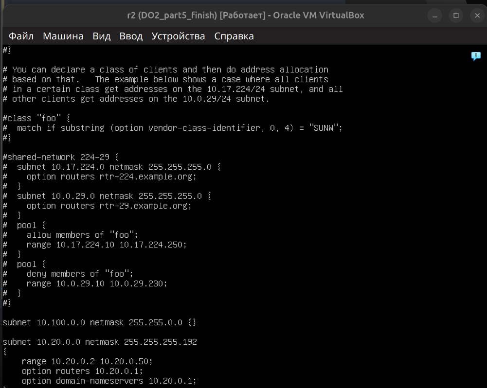

DHCP-сервер привязан к интерфейсу LAN 2 через `/etc/default/isc-dhcp-server`:

```text
INTERFACESv4="enp0s8"
```

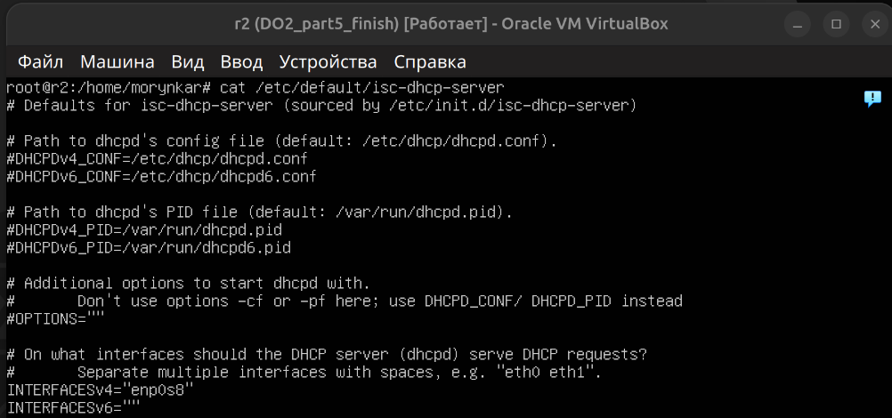

На самом маршрутизаторе проверен DNS resolver с `nameserver 8.8.8.8`.

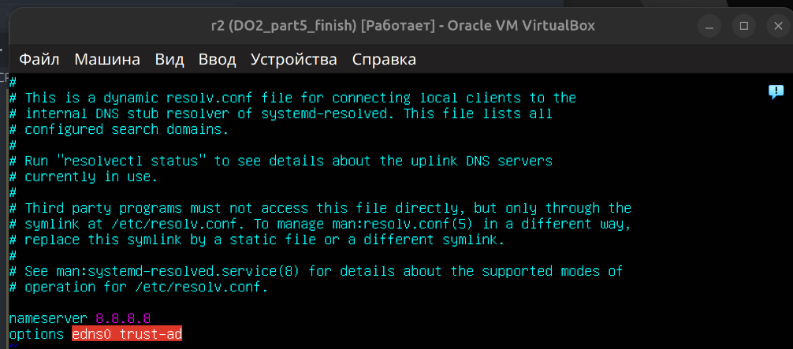

По лабораторному сценарию после перезапуска DHCP-сервера машина `ws21` перезагружается. После загрузки клиент должен получить адрес и маршрут автоматически; результат проверяется командами `ip a` и `ping` до статического узла `ws22`:

```bash
# r2
sudo systemctl restart isc-dhcp-server

# ws21
sudo reboot
ip a
ping 10.20.0.20
```

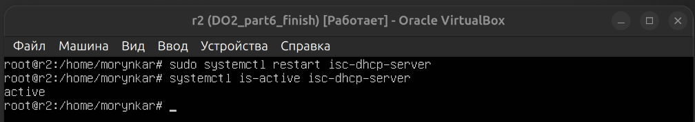

После перезагрузки клиент получил адрес `10.20.0.3/26` с конечным сроком аренды. Таблица маршрутизации содержит записи `proto dhcp`, а `ping` подтверждает доступность статического узла `ws22`:

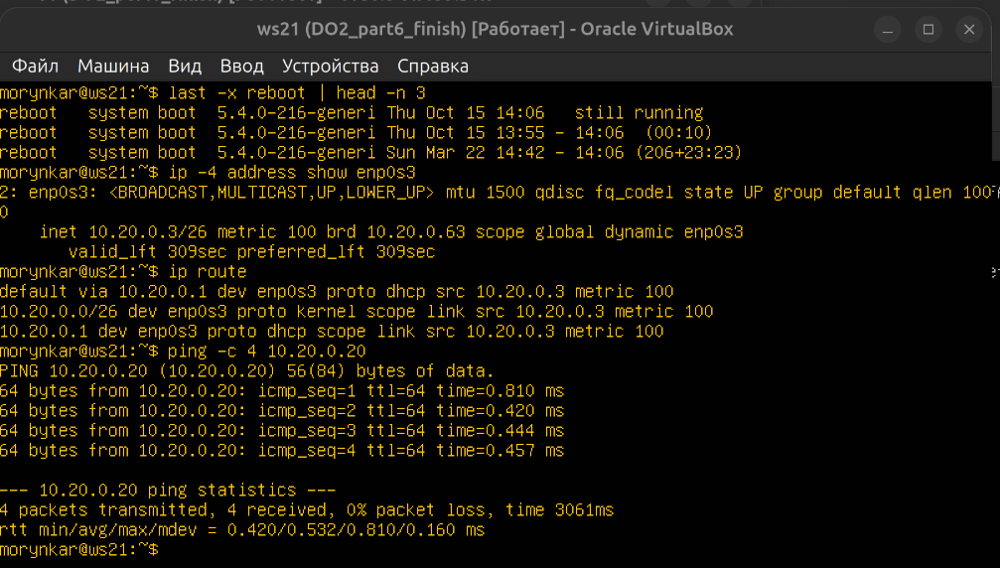

Исходный лабораторный кадр со статическим адресом до переключения Netplan на DHCP также сохранён как часть последовательности настройки:

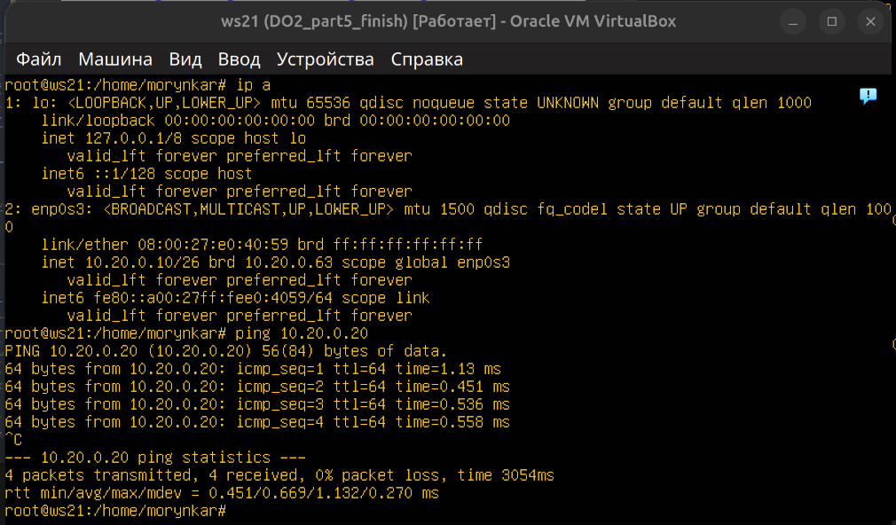

При запуске DHCP-клиент выполняет обмен DHCPDISCOVER → DHCPOFFER → DHCPREQUEST → DHCPACK. Первичная выдача после перезагрузки подтверждена адресом `10.20.0.3`, а повторный запрос lease ниже — адресом `10.20.0.2` и подробным протокольным обменом.

## Reservation по MAC

На `ws11` включён DHCP и задан лабораторный MAC-адрес:

```yaml
dhcp4: true
macaddress: 10:10:10:10:10:ba
```

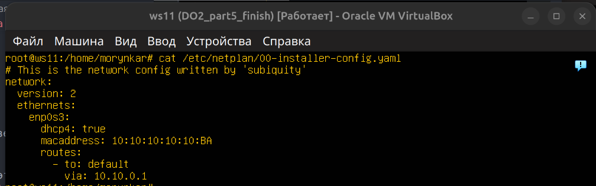

На `r1` создано закрепление адреса:

```dhcpd
host ws11 {
    hardware ethernet 10:10:10:10:10:ba;
    fixed-address 10.10.0.2;
}
```

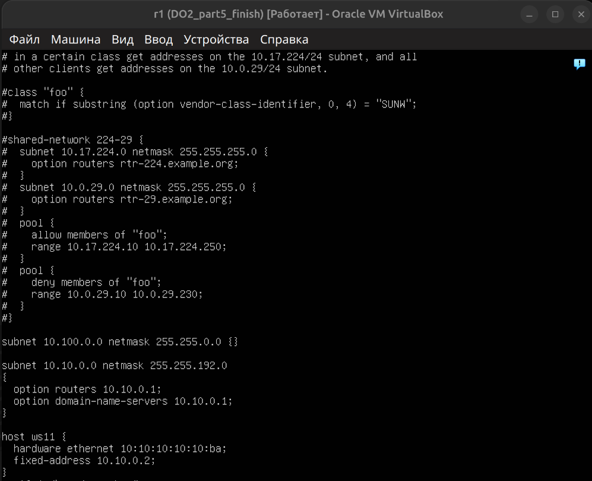

Сервер `r1` привязан к интерфейсу `enp0s3`, который смотрит в сеть `10.10.0.0/18`.

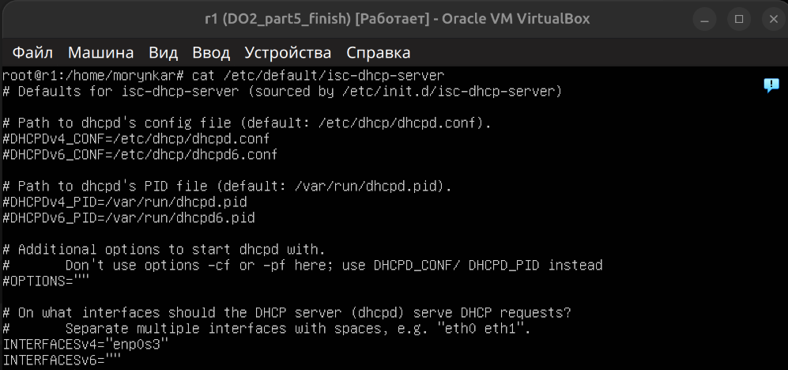

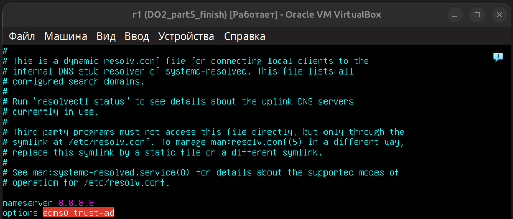

Результат reservation подтверждён на клиенте: MAC `10:10:10:10:10:ba`, динамически назначенный адрес `10.10.0.2/18`, DHCP-маршрут через `10.10.0.1` и связь со шлюзом:

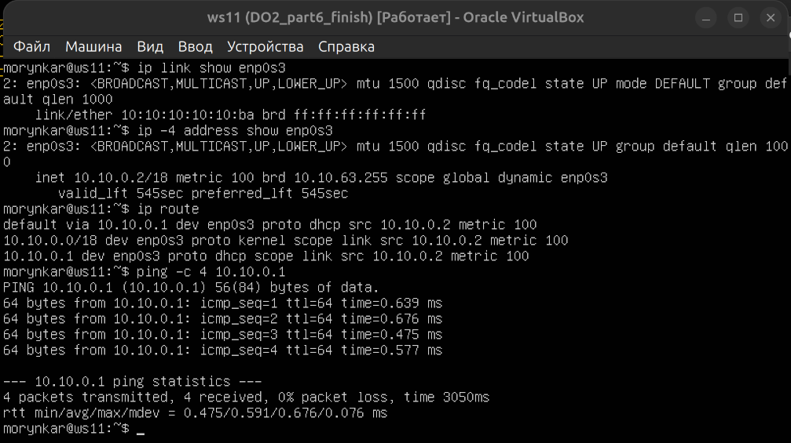

## Обновление аренды

Для повторной проверки динамического сценария старая аренда освобождена, после чего клиент запросил новую конфигурацию:

```bash
sudo dhclient -r enp0s3
sudo dhclient -v enp0s3
```

Ключ `-r` отправляет DHCPRELEASE и удаляет текущую аренду, а `-v` показывает подробный обмен сообщениями при получении нового адреса.

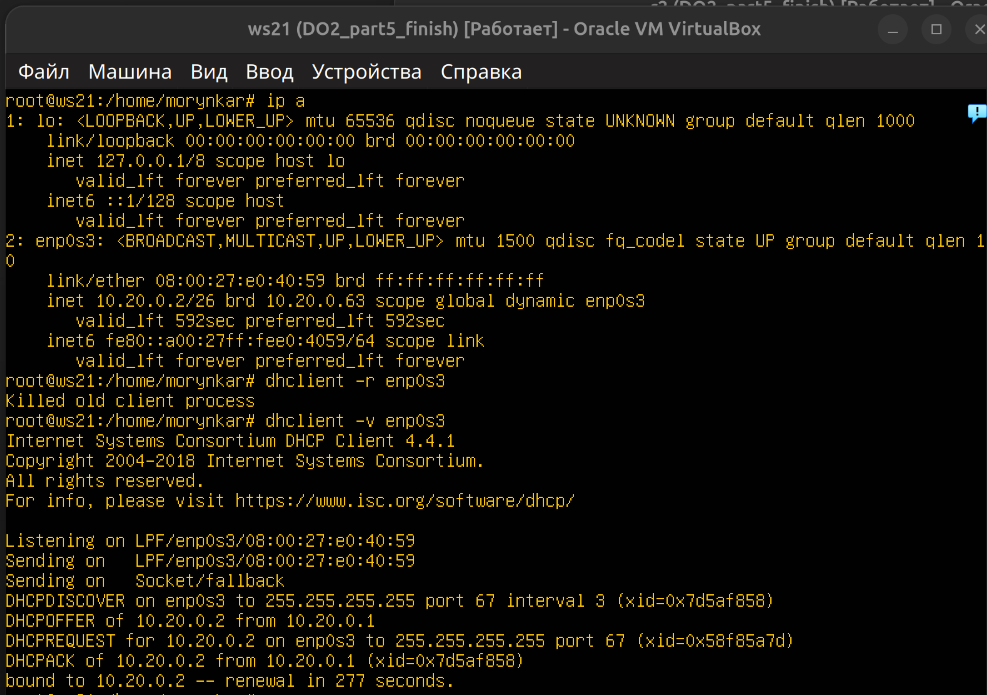

Дополнительный исходный кадр той же проверки показывает `ws21`, получивший динамический адрес `10.20.0.2` после обмена DHCPDISCOVER → DHCPOFFER → DHCPREQUEST → DHCPACK:

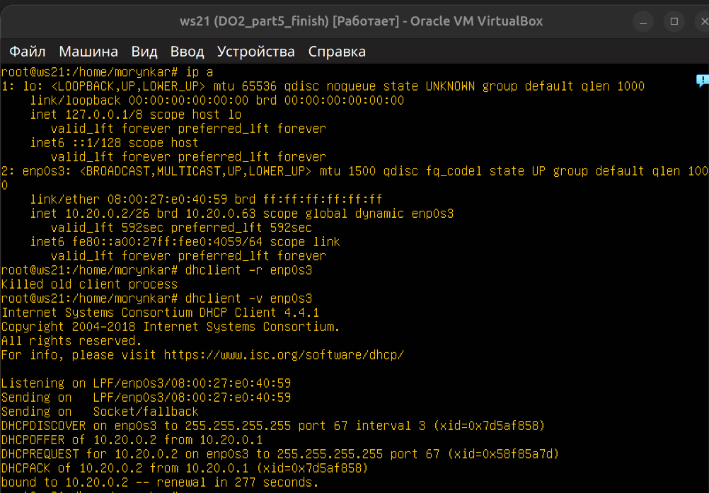

Перед запуском конфигурация проверяется без изменения состояния службы:

```bash
sudo dhcpd -t -cf /etc/dhcp/dhcpd.conf
```

## Использованные параметры DHCP

- `range` задаёт динамический пул адресов;
- `option routers` передаёт клиенту default gateway;
- `option domain-name-servers` передаёт DNS-сервер;
- `hardware ethernet` сопоставляет reservation с MAC клиента;
- `fixed-address` закрепляет конкретный IPv4-адрес;
- `default-lease-time` и `max-lease-time` управляют сроком аренды.

## Результат

`ws21` получает адрес из динамического пула `r2`, а `ws11` стабильно получает `10.10.0.2` от `r1` благодаря reservation. Статический адрес `ws22` исключён из пула, поэтому DHCP не может выдать его другому клиенту.

---

[← Предыдущий этап: Part 5 — маршрутизация сети](routing.md) | [Следующий этап: Part 7 — NAT →](nat.md)
