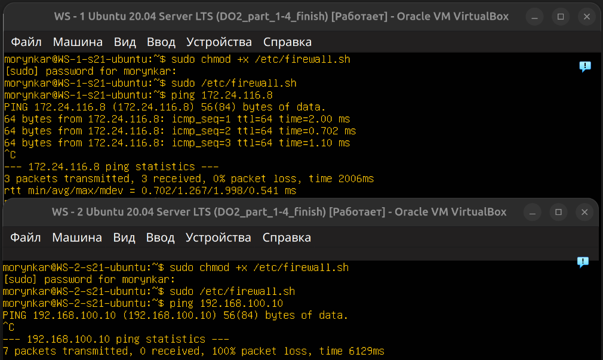
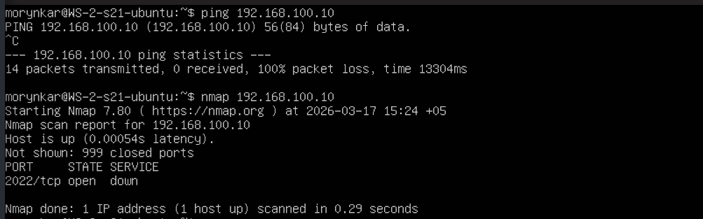

# Firewall и обнаружение узлов

Эксперимент демонстрирует порядок обработки правил `iptables`: цепочка просматривается сверху вниз, а первое совпавшее завершающее действие определяет судьбу пакета.

Для ICMP echo reply корректный синтаксис имеет вид:

```bash
sudo iptables -A OUTPUT -p icmp --icmp-type echo-reply -j ACCEPT
sudo iptables -A OUTPUT -p icmp --icmp-type echo-reply -j DROP
```

Если поменять эти правила местами, результат изменится. Безусловная очистка системных цепочек для такого опыта не требуется: скрипты [`firewall-ws1.sh`](../scripts/firewall-ws1.sh) и [`firewall-ws2.sh`](../scripts/firewall-ws2.sh) используют собственную цепочку `DO2_ICMP_OUT`.



Отсутствие ответа на `ping` не доказывает, что узел выключен: ICMP может фильтроваться. Дополнительная проверка через `nmap` обнаружила доступный TCP-сервис:

```bash
ping -c 4 192.168.100.10
nmap -Pn 192.168.100.10
```



`nmap -Pn` пропускает предварительную host-discovery проверку и сканирует заданный узел как доступный. Запускать сканирование следует только в собственной лабораторной сети.
