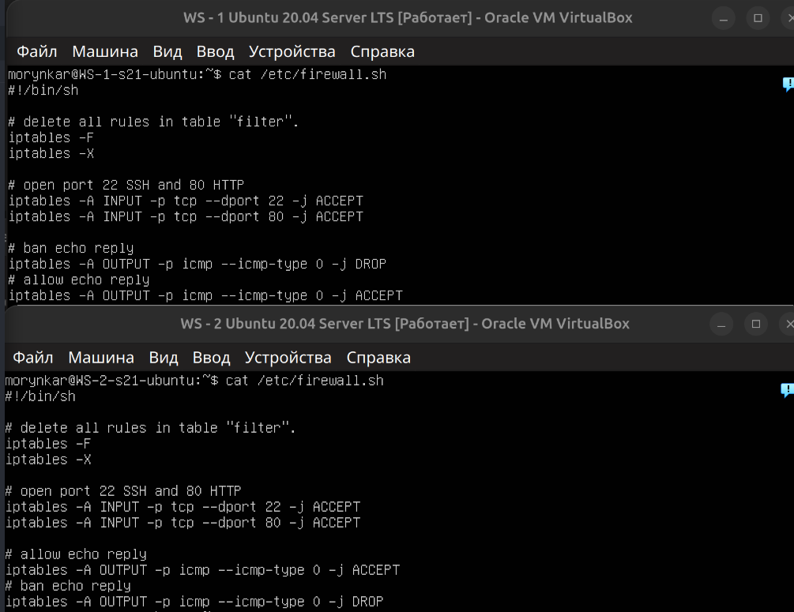

# Part 4. Сетевой экран и обнаружение узлов

[← README](../README.md) · [Схема](topology.md) · [Part 1](addressing.md#part-1-расчёт-сетей-и-адресов) · [Part 2](addressing.md#part-2-статическая-маршрутизация-между-двумя-машинами) · [Part 3](addressing.md#part-3-измерение-скорости-соединения) · **Part 4** · [Part 5](routing.md) · [Part 6](dhcp.md) · [Part 7](nat.md) · [Part 8](ssh-tunnels.md)

---

## Цель этапа

Проверить последовательную модель `iptables`: одинаковые правила, добавленные в разном порядке, дают разный результат. Второй опыт показывает, почему отсутствие ICMP-ответа нельзя автоматически считать признаком выключенного узла.

Эксперимент демонстрирует порядок обработки правил `iptables`: цепочка просматривается сверху вниз, а первое совпавшее завершающее действие определяет судьбу пакета.

Для ICMP echo reply корректный синтаксис имеет вид:

```bash
sudo iptables -A OUTPUT -p icmp --icmp-type echo-reply -j ACCEPT
sudo iptables -A OUTPUT -p icmp --icmp-type echo-reply -j DROP
```

На `ws1` запрещающее правило записано первым, а разрешающее — вторым. На `ws2` порядок обратный. Порты TCP 22 и 80 разрешены отдельными правилами во входящей цепочке.



Если поменять правила местами, результат изменится. Безусловная очистка системных цепочек для повторного запуска не требуется: скрипты [`firewall-ws1.sh`](../scripts/firewall-ws1.sh) и [`firewall-ws2.sh`](../scripts/firewall-ws2.sh) используют собственную цепочку `DO2_ICMP_OUT`. Исходный лабораторный скриншот сохраняет выполненный вариант с очисткой таблицы.


Отсутствие ответа на `ping` не доказывает, что узел выключен: ICMP может фильтроваться. Дополнительная проверка через `nmap` обнаружила доступный TCP-сервис:

```bash
ping -c 4 192.168.100.10
nmap -Pn 192.168.100.10
```


`nmap -Pn` пропускает предварительную host-discovery проверку и сканирует заданный узел как доступный. Запускать сканирование следует только в собственной лабораторной сети.

## Что происходит с пакетом

Входящий echo request принимается узлом, а echo reply попадает в цепочку `OUTPUT`. На `ws1` первым совпадает `DROP`, поэтому эта машина не отвечает на чужой `ping`. На `ws2` первым совпадает `ACCEPT`, поэтому ответ уходит. Именно поэтому `ws1` успешно пингует `ws2`, а обратный `ping` с `ws2` к `ws1` теряется. `nmap` при этом может обнаружить открытый TCP-порт независимо от ответа на ICMP.

## Результат

Практически подтверждены принцип first match и различие между доступностью конкретного протокола и доступностью самого узла. Для повторения опыта используются отдельные цепочки, не очищающие остальные правила машины.

---

[← Предыдущий этап: Part 3 — измерение скорости](addressing.md#part-3-измерение-скорости-соединения) | [Следующий этап: Part 5 — маршрутизация сети →](routing.md)
