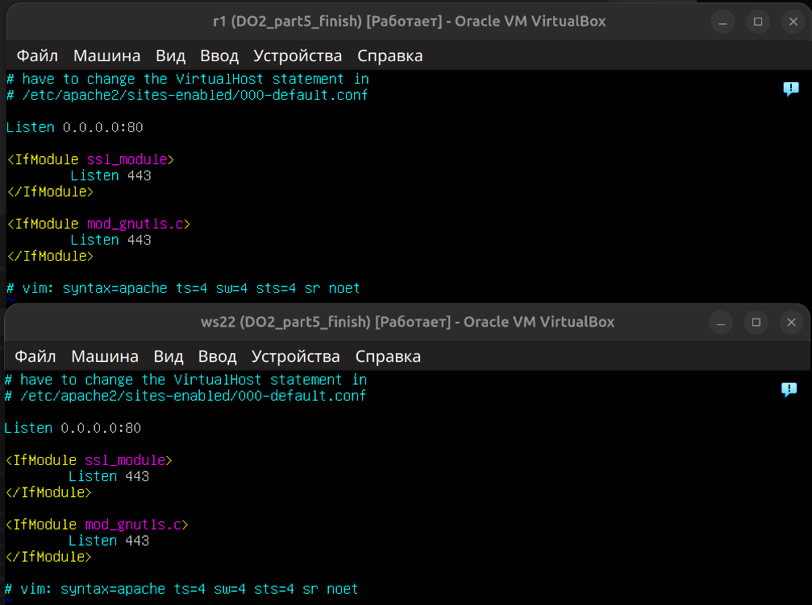
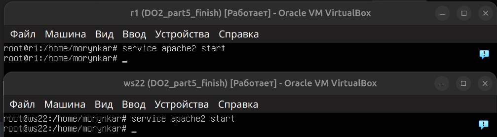
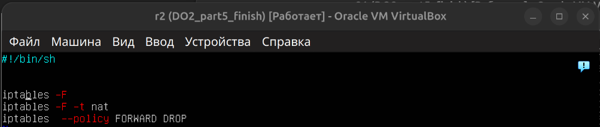
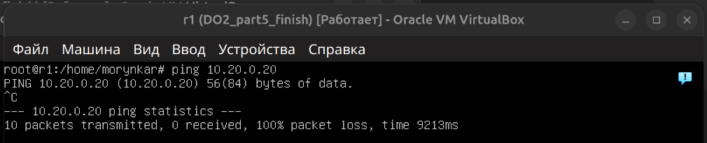
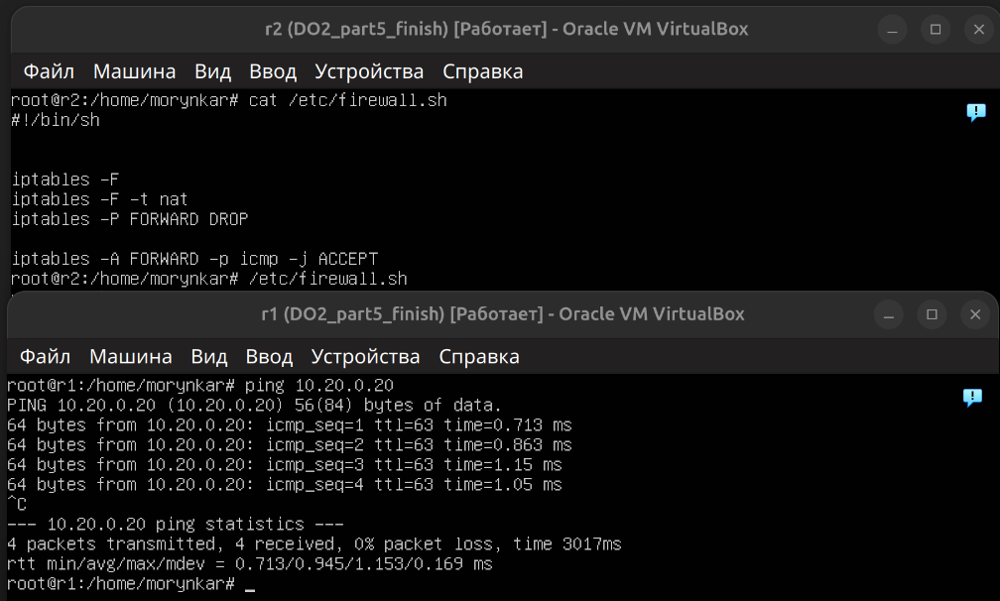
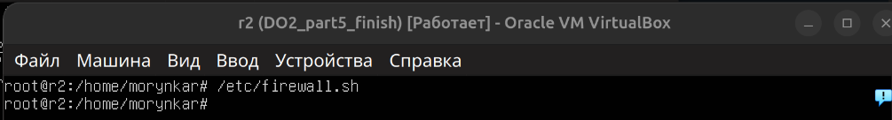
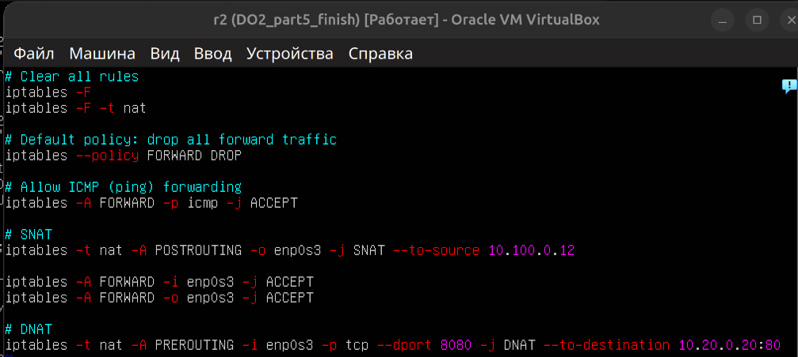
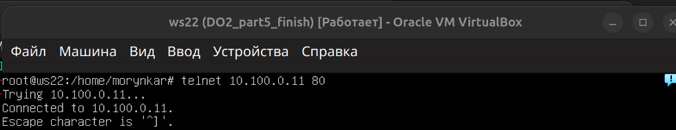
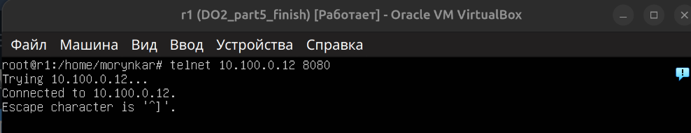

# NAT

[← README](../README.md) · [Топология](topology.md) · [Адресация](addressing.md) · [Firewall](firewall.md) · [Маршрутизация](routing.md) · [DHCP](dhcp.md) · **NAT** · [SSH-туннели](ssh-tunnels.md)

---

## Цель этапа

Показать отдельно фильтрацию транзитных пакетов и преобразование адресов. Сначала маршрутизатор блокирует forwarding, затем разрешает необходимый трафик, после чего SNAT изменяет источник исходящего соединения, а DNAT направляет входящий трафик к внутреннему веб-сервису.

На `ws22` запущен Apache, а `r2` выполняет фильтрацию и преобразование адресов. Политика `FORWARD DROP` дополняется явными разрешающими правилами для установленных соединений и трафика лаборатории.

## Подготовка веб-сервера

Для первого NAT-эксперимента Apache слушает порт `80` на всех интерфейсах `ws22`:

```apache
Listen 0.0.0.0:80
```



Веб-сервер запущен на `ws22` и `r1`, после чего состояние службы проверено:

```bash
sudo service apache2 start
sudo service apache2 status
```



## Проверка политики FORWARD

На `r2` установлена политика по умолчанию `DROP` для транзитного трафика. Она не блокирует соединения с самим маршрутизатором, но запрещает пакетам проходить между его интерфейсами.



До добавления разрешающего правила `ping` из одного сегмента в другой не проходит:



После разрешения ICMP пакеты снова пересылаются:

```bash
sudo iptables -A FORWARD -p icmp -j ACCEPT
```



## SNAT

SNAT заменяет адрес источника пакетов, выходящих из LAN 2 через transit-сегмент:

```bash
sudo iptables -t nat -A POSTROUTING -o enp0s3 \
    -j SNAT --to-source 10.100.0.12
```

Фиксированный SNAT подходит, когда внешний адрес известен заранее. Для динамического внешнего адреса обычно применяют `MASQUERADE`.

## DNAT

DNAT направляет запросы к Apache на `ws22` через порт `8080` маршрутизатора:

```bash
sudo iptables -t nat -A PREROUTING -i enp0s3 -p tcp --dport 8080 \
    -j DNAT --to-destination 10.20.0.20:80
```

Полный идемпотентный лабораторный пример находится в [`scripts/nat-router.sh`](../scripts/nat-router.sh).

После применения правил таблицы `filter` и `nat` проверяются отдельно:

```bash
sudo iptables -S
sudo iptables -t nat -S
```





Проверка исходящего соединения:

```bash
telnet 10.100.0.11 80
```



Проверка доступа к сервису:

```bash
telnet 10.100.0.12 8080
```



`curl` или `nc` предпочтительнее `telnet` для новых сценариев автоматической проверки, но на скриншотах сохранён фактически выполненный эксперимент.

## Что происходит с соединениями

- При SNAT пакет от `ws22` выходит через `r2` с источником `10.100.0.12`; ответ возвращается маршрутизатору, который восстанавливает исходный адрес клиента.
- При DNAT соединение к `10.100.0.12:8080` преобразуется в соединение к `10.20.0.20:80`; обратное преобразование выполняется автоматически средствами conntrack.
- Разрешение `ESTABLISHED,RELATED` позволяет возвращать ответы уже установленных соединений без широкого открытия всего транзитного трафика.

## Результат

Подтверждены блокировка и последующее разрешение forwarding, доступ `ws22` к удалённому Apache через SNAT и перенаправление входящих запросов к внутреннему Apache через DNAT.

---

[← Предыдущий этап: DHCP](dhcp.md) | [Следующий этап: SSH-туннели →](ssh-tunnels.md)
