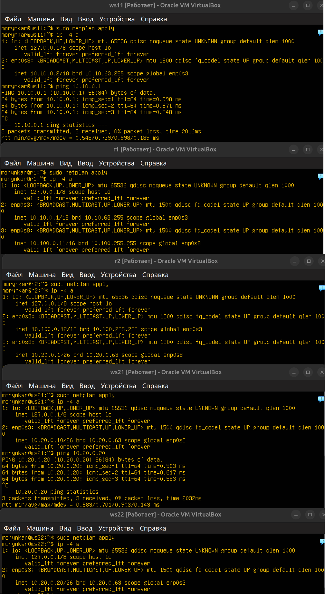
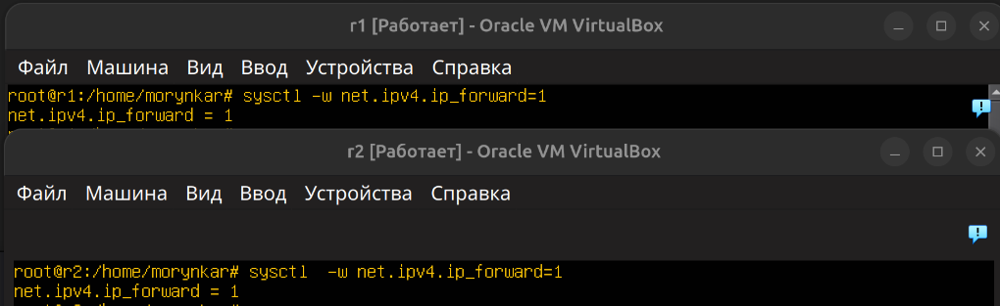
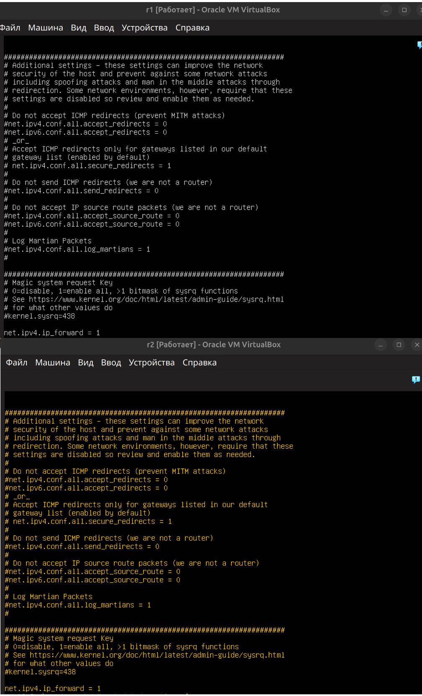
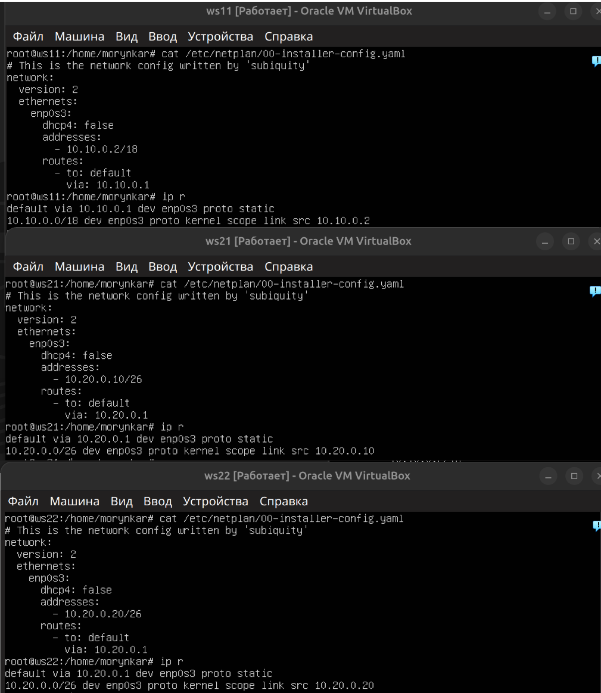
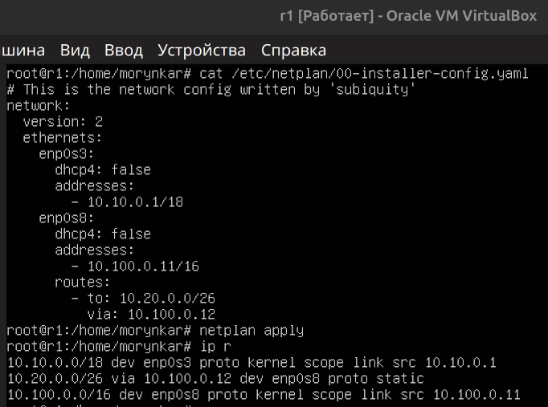
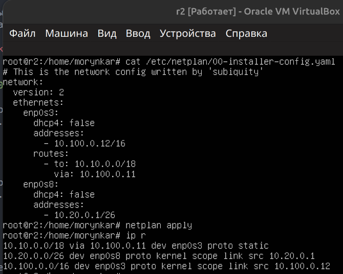
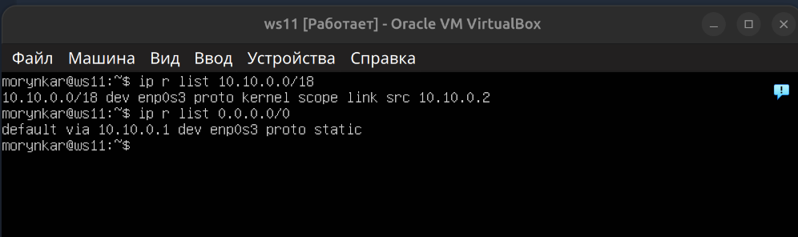
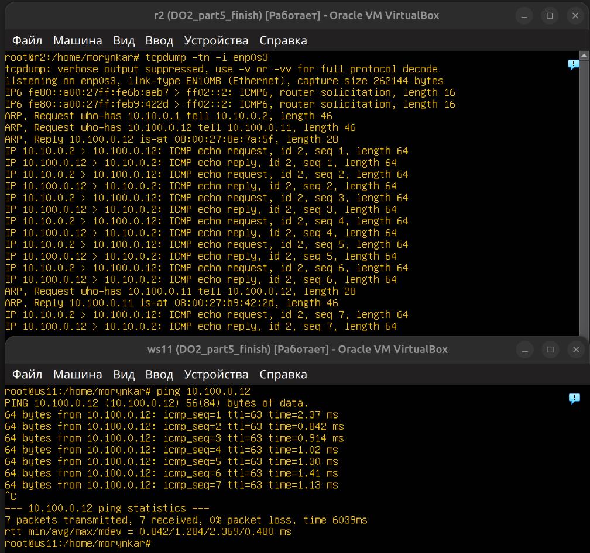
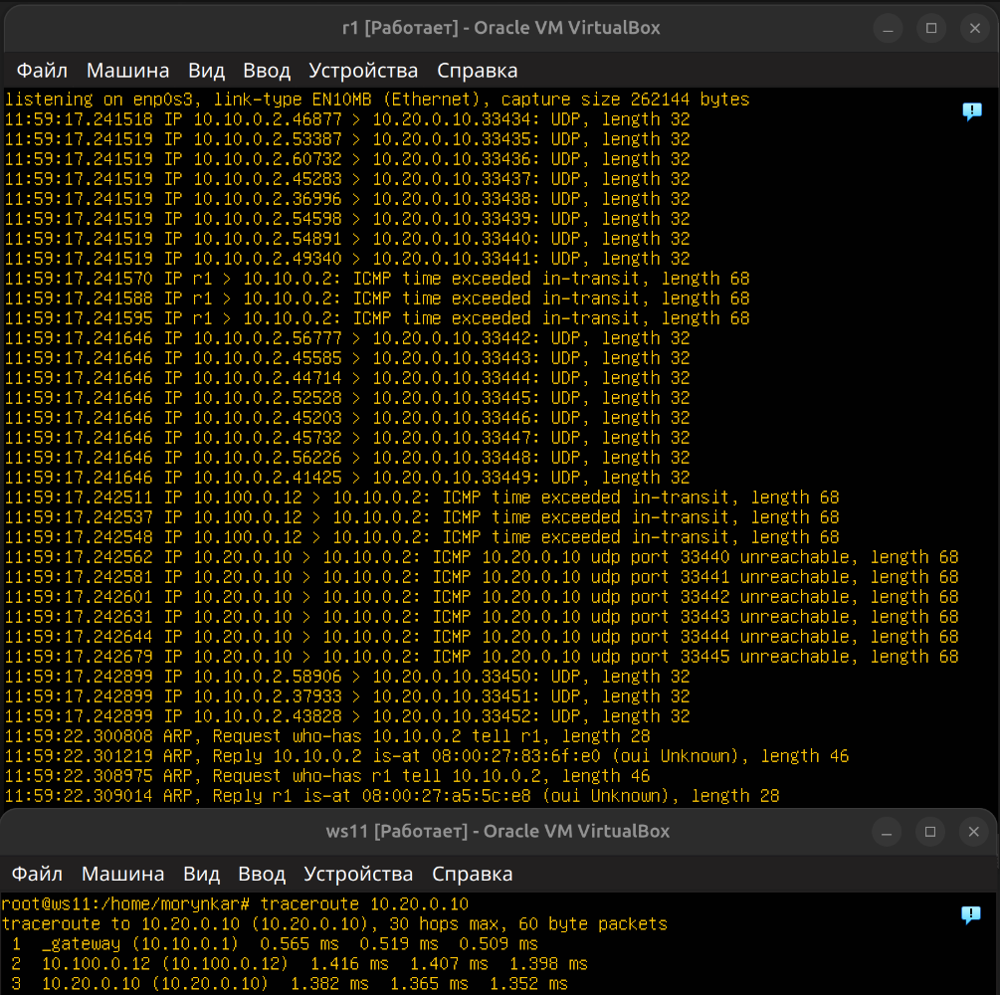
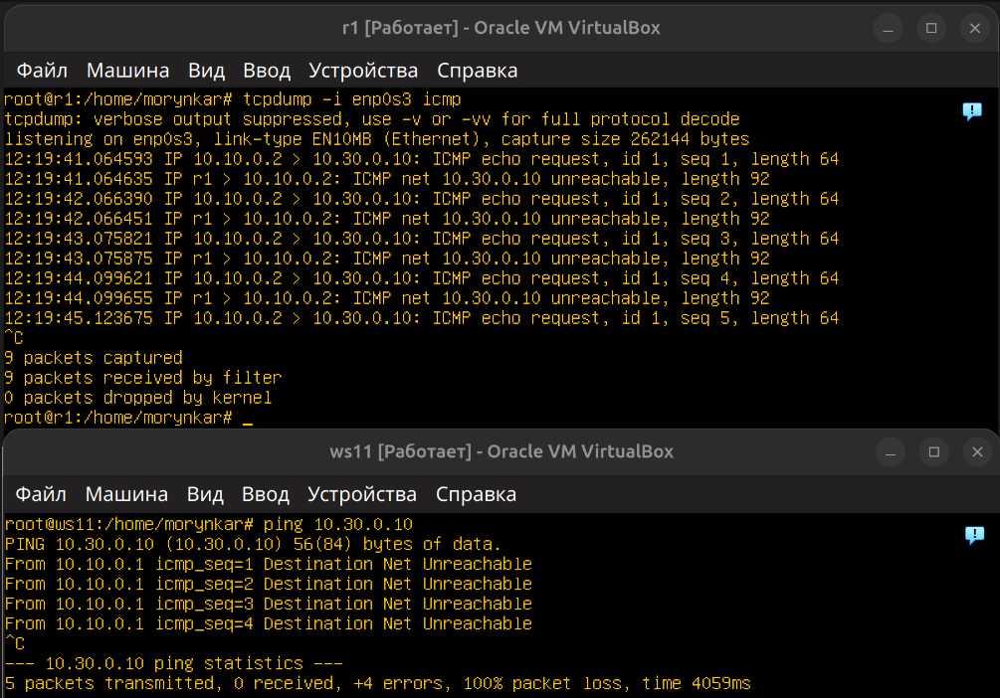

# Многоузловая маршрутизация

[← README](../README.md) · [Топология](topology.md) · [Адресация](addressing.md) · [Firewall](firewall.md) · **Маршрутизация** · [DHCP](dhcp.md) · [NAT](nat.md) · [SSH-туннели](ssh-tunnels.md)

---

## Цель этапа

Соединить две пользовательские подсети через transit-сегмент и два Linux-маршрутизатора. В отличие от предыдущего опыта, пакет теперь должен пройти несколько узлов, а каждый роутер обязан знать путь к удалённой сети.

## Адреса и локальная связность

Netplan настроен на всех пяти машинах: `ws11`, `ws21`, `ws22`, `r1` и `r2`. После `sudo netplan apply` адреса проверены через `ip -4 address`. До настройки маршрутизации проверена связность внутри непосредственно подключённых сегментов: `ws21` пингует `ws22`, а `ws11` — интерфейс `r1`.



## IP forwarding и default routes

На `r1` и `r2` включена пересылка IPv4-пакетов:

```bash
sudo sysctl -w net.ipv4.ip_forward=1
```

Команда меняет параметр работающего ядра до ближайшей перезагрузки. Значение `1` разрешает принимать пакет на одном интерфейсе и передавать его через другой.



Постоянное значение хранится в [`configs/sysctl/99-do2-router.conf`](../configs/sysctl/99-do2-router.conf). Рабочие станции используют ближайший роутер как маршрут по умолчанию.

```bash
sudo sysctl --system
sysctl net.ipv4.ip_forward
```





## Маршруты между LAN

На `r1` добавлен маршрут к `10.20.0.0/26` через `10.100.0.12`, а на `r2` — к `10.10.0.0/18` через `10.100.0.11`.

Это зеркальные маршруты: `r1` знает, что правая LAN находится за `r2`, а `r2` знает путь обратно к левой LAN. Рабочим станциям подробная карта сети не нужна — неизвестные назначения они передают своему default gateway.





При нескольких подходящих записях ядро выбирает наиболее специфичный маршрут — с самым длинным совпадающим префиксом. Поэтому маршрут `/18` имеет приоритет над default route `/0`.

На `ws11` это проверено отдельными запросами к таблице:

```bash
ip route list 10.10.0.0/18
ip route list 0.0.0.0/0
```



Отдельно трафик наблюдался на `r2`:

```bash
sudo tcpdump -tn -i enp0s3
```

В дампе видны ARP-запросы и пакеты, поступающие из transit-сегмента. ARP нужен маршрутизатору для определения MAC-адреса следующего узла внутри непосредственно подключённой сети.



## Наблюдение за пакетами

Путь от `ws11` до `ws21` проверен одновременно через `traceroute` и `tcpdump`:

```bash
# r1
sudo tcpdump -n -i enp0s3

# ws11
traceroute 10.20.0.10
```



`traceroute` увеличивает TTL последовательных пакетов. При обнулении TTL промежуточный маршрутизатор возвращает ICMP Time Exceeded, благодаря чему становится виден путь.

Для проверки ошибки маршрутизации отправлен пакет в отсутствующую сеть:

```bash
sudo tcpdump -n -i enp0s3 icmp
ping -c 1 10.30.0.10
```

Здесь исправлена опечатка исходного отчёта: фактический интерфейс называется `enp0s3`, что подтверждено скриншотом.



## Результат

`ws11`, `ws21` и `ws22` получили сквозную связность через `r1` и `r2`. `traceroute` подтвердил оба перехода, `tcpdump` показал реальные пакеты на интерфейсах, а опыт с отсутствующей сетью продемонстрировал возврат ICMP Destination Unreachable.

---

[← Предыдущий этап: firewall](firewall.md) | [Следующий этап: DHCP →](dhcp.md)
