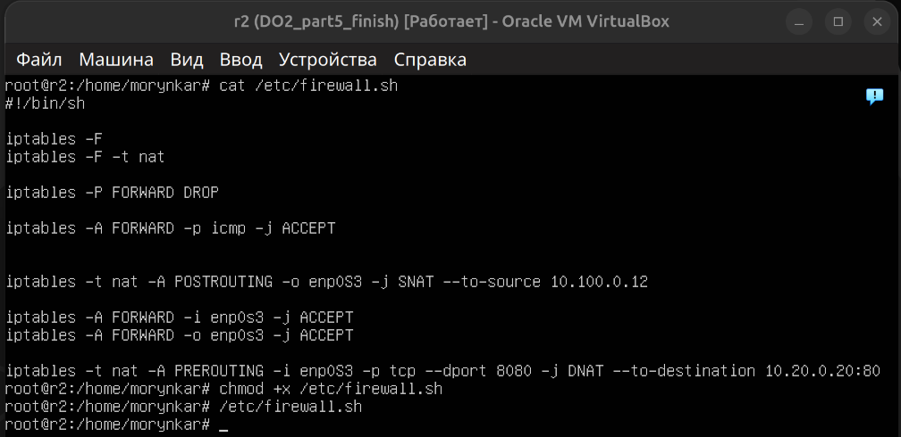
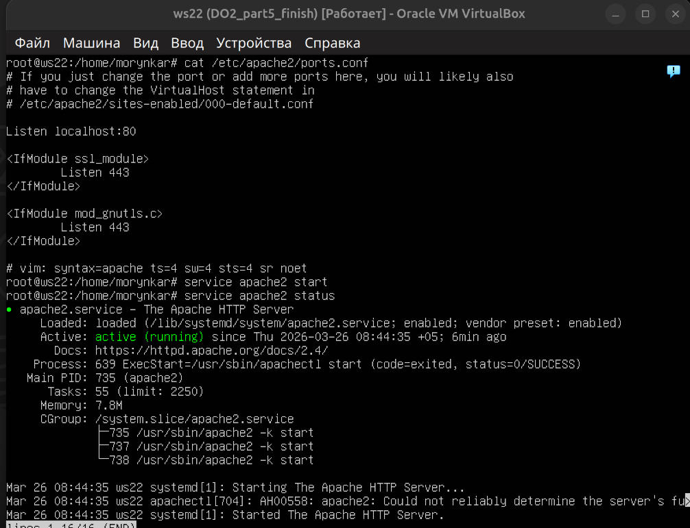
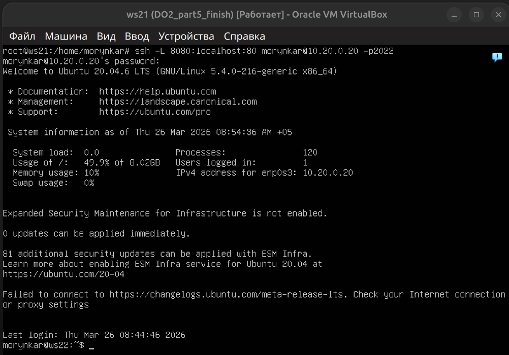
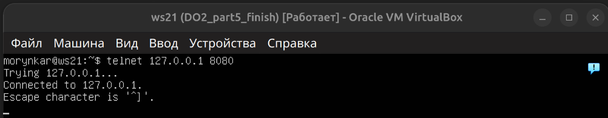
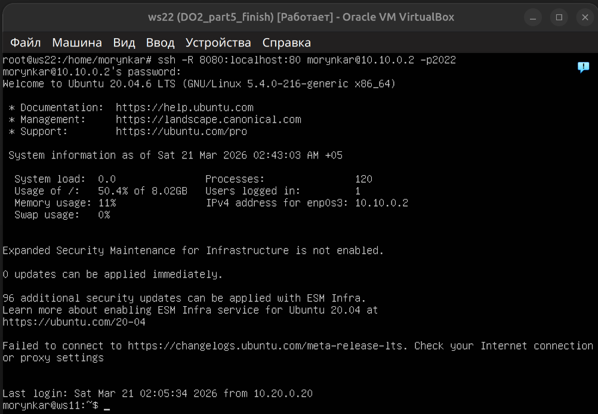
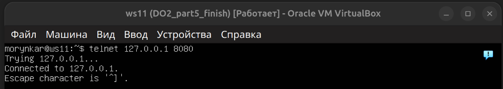

# Part 8. SSH-туннели

[← README](../README.md) · [Схема](topology.md) · [Part 1](addressing.md#part-1-расчёт-сетей-и-адресов) · [Part 2](addressing.md#part-2-статическая-маршрутизация-между-двумя-машинами) · [Part 3](addressing.md#part-3-измерение-скорости-соединения) · [Part 4](firewall.md) · [Part 5](routing.md) · [Part 6](dhcp.md) · [Part 7](nat.md) · **Part 8**

---

## Цель этапа

Получить доступ к веб-сервису, который слушает только loopback удалённой машины и поэтому недоступен напрямую из сети. В опыте сравниваются локальное и удалённое перенаправление TCP-портов через зашифрованное SSH-соединение.

Перед созданием туннелей на `r2` применены подготовленные firewall/NAT-правила предыдущего этапа.



Apache на `ws22` привязан к loopback и напрямую из сети недоступен:

```apache
Listen 127.0.0.1:80
```



## Local port forwarding

Локальный туннель используется, когда клиенту нужен доступ к сервису на стороне SSH-сервера. Слушающий порт создаётся на машине, где запускается команда `ssh`.

На `ws21` локальный порт `8080` направлен через SSH к loopback-порту Apache на `ws22`:

```bash
ssh -L 8080:localhost:80 morynkar@10.20.0.20 -p2022
```

Короткая опция OpenSSH допускает как `-p2022`, так и `-p 2022`; в документации сохранена фактически использованная форма.

Здесь `8080` — локальный порт `ws21`, `localhost:80` трактуется со стороны `ws22`, а `10.20.0.20:2022` — адрес SSH-сервера.



```bash
telnet 127.0.0.1 8080
```



## Remote port forwarding

Обратный туннель применяется, когда нужно открыть на удалённой стороне порт, ведущий к сервису со стороны SSH-клиента.

С `ws22` создан обратный туннель к `ws11`. В результате порт `8080` на `ws11` ведёт к локальному Apache `ws22`:

```bash
ssh -R 8080:localhost:80 morynkar@10.10.0.2 -p2022
```



```bash
telnet 127.0.0.1 8080
```



В этой команде порт `8080` открывается на `ws11`, а данные через SSH-сессию передаются к `localhost:80` машины `ws22`. Строка `Connected to 127.0.0.1` в обоих опытах подтверждает установление TCP-соединения через туннель.

В production-сценарии дополнительно применяются ключевая аутентификация, `ExitOnForwardFailure=yes`, ограничения `AllowTcpForwarding` и контроль адреса привязки порта.

## Результат

Оба туннеля обеспечили доступ к Apache, хотя сервис оставался привязанным к `127.0.0.1`. Эксперимент показывает, что SSH может защищённо переносить произвольный TCP-трафик не открывая внутренний сервис на сетевом интерфейсе.

---

[← Предыдущий этап: Part 7 — NAT](nat.md) | [Завершить и вернуться в README →](../README.md)
