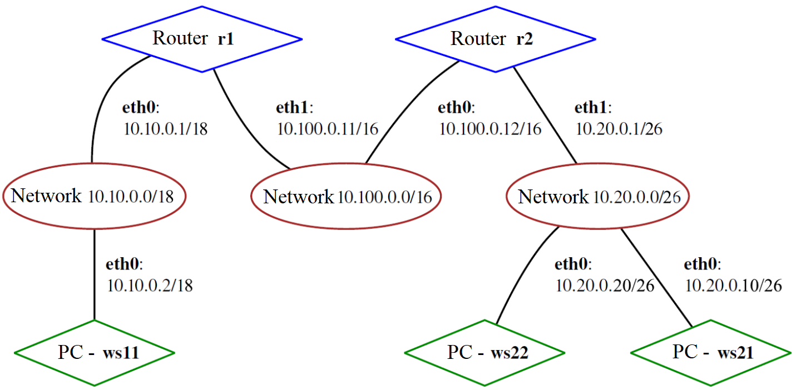
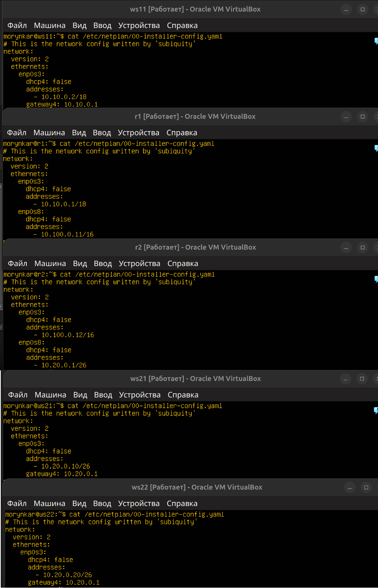

# Топология и адресный план

Стенд состоит из трёх рабочих станций и двух Linux-маршрутизаторов. Все сегменты работают во внутренних сетях VirtualBox.



| Сегмент | CIDR | Устройства |
|---|---|---|
| LAN 1 | `10.10.0.0/18` | `ws11`, `r1` |
| Transit | `10.100.0.0/16` | `r1`, `r2` |
| LAN 2 | `10.20.0.0/26` | `r2`, `ws21`, `ws22` |

`r1` и `r2` имеют по два интерфейса и пересылают IPv4-пакеты между сегментами. Рабочие станции используют ближайший маршрутизатор как default gateway. На маршрутизаторах заданы взаимные статические маршруты к удалённым LAN.

Параметры интерфейсов проверялись после каждого изменения:

```bash
ip -brief -4 address
ip route
```



В репозитории приведены отдельные примеры Netplan для [`ws11`](../configs/netplan/ws11.yaml), [`r1`](../configs/netplan/r1.yaml) и [`r2`](../configs/netplan/r2.yaml). Перед применением необходимо проверить реальные имена интерфейсов через `ip link`.
